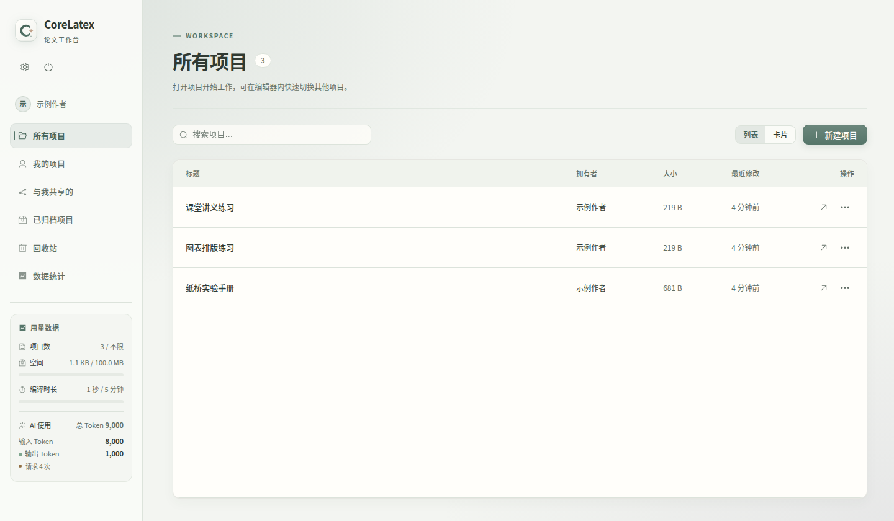
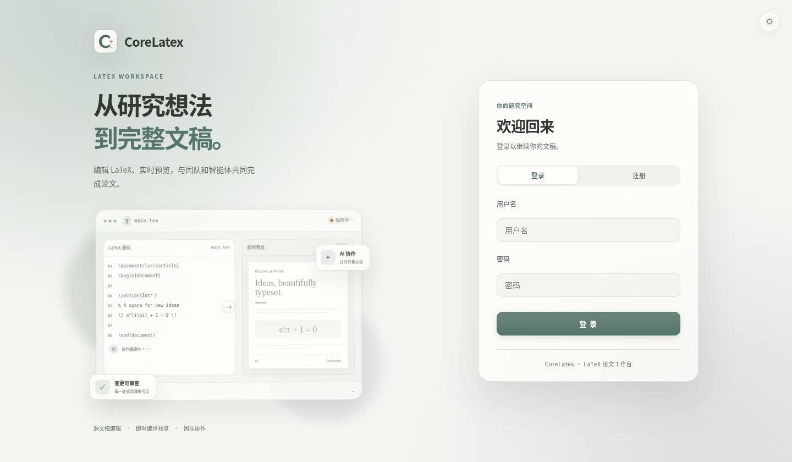
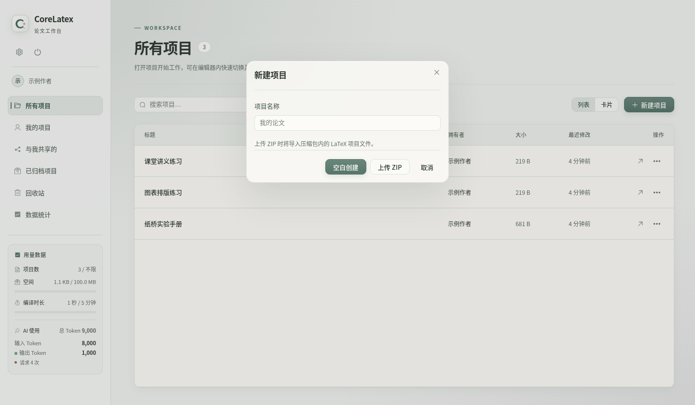
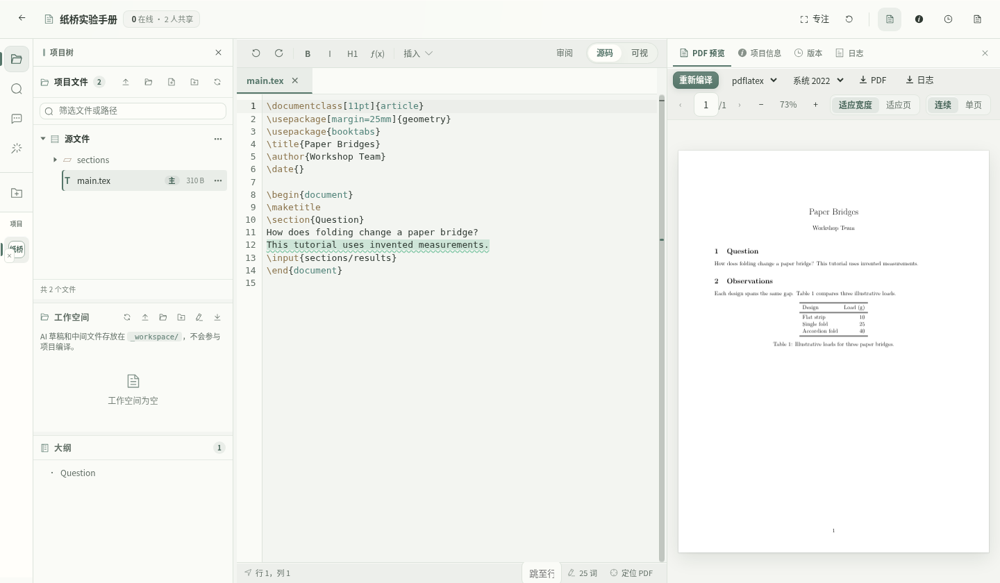
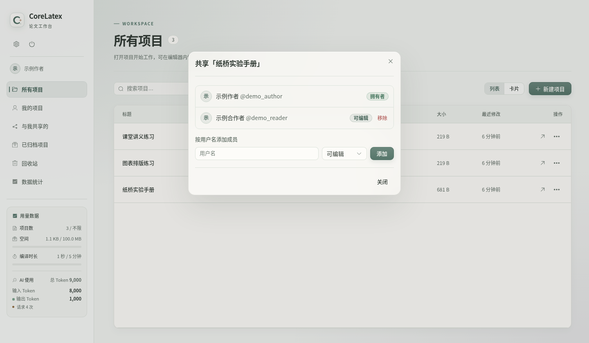
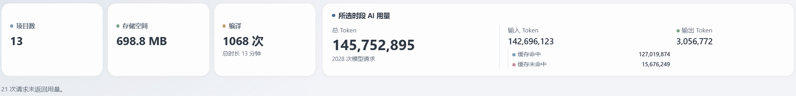

# CoreLatex 用户手册

CoreLatex 让作者在浏览器里编写 LaTeX、与合作者编辑同一份文稿、生成 PDF，并按需使用 CoreAgent 辅助修改。第一次打开工作台，可以先用本页的纸桥示例完成一次「导入 → 编译 → 修改 → 再编译」。这个练习只需要普通账号和一个可用的 TeX 环境。

*图中「纸桥实验手册」是接下来要用的项目。点项目名称进入编辑器，点同一行最右侧的 ⋯ 管理共享或导出源码。*

## 按任务查阅

| 我想做什么 | 阅读章节 |
| --- | --- |
| 跑通第一个文稿，知道成功时应该看到什么 | 本页的「第一次使用」和「编译并改一处内容」 |
| 导入自己的模板，与合作者写作、批注、查错或恢复版本 | [项目协作与 LaTeX 编译](editing-and-compilation.md) |
| 配置模型，让 AI 修改选区，检查变更集，读懂 Token、缓存和上下文 | [CoreAgent、模型与用量](coreagent-and-usage.md) |
| 自行部署、开通账号、设置配额、安装 TeX 或备份数据 | [安装与管理员指南](installation-and-admin.md) |

## 第一次使用

1. **登录工作台。** 打开管理员提供的网址。已有账号时，在「登录」页输入用户名和密码。允许注册的站点可切到 **注册**，填写用户名、昵称和密码，再点 **注册并登录**。用户名用于登录和共享项目，昵称用于在界面中显示。如果站点已经关闭注册，请管理员开通账号。
2. **下载练习项目。** 保存 [paper-bridges.zip](examples/paper-bridges.zip?raw=true)，保持压缩包原样。这个多文件示例用于练习导入、编译、编辑子文件和协作。包里有入口文件 `main.tex` 和结果章节 `sections/results.tex`，PDF 的英文标题是 *Paper Bridges*。
3. **导入 ZIP。** 在项目首页右上角点 **新建项目**，将「项目名称」填为「纸桥实验手册」，点 **上传 ZIP**，选中刚保存的文件。回到列表后点项目名进入编辑器。自己从零写论文时，可以在同一处选择 **空白创建**。

*已有账号直接登录。要分辨两个同昵称的合作者，可以在共享窗口中核对各自的用户名。*

*导入练习包请点「上传 ZIP」。源文件和子目录会一起导入，其他人无需逐个上传文件。*

## 编译并改一处内容

1. 在左侧 **项目文件** 找到带「主」标记的 `main.tex`。其中的 `\input{sections/results}` 把结果章节接到了正文中。
2. 在右侧 **PDF 预览** 工具栏选择 `pdflatex` 和站点已启用的 TeX Live 版本，点 **重新编译**。如果新项目预选的年度版本尚未安装，可以选可用的「系统」版本跑本示例。成功后能看到一页 PDF，标题为 *Paper Bridges*，表中有三行示例载荷 **10、25、40 g**。
3. 展开左侧 `sections` 文件夹，打开 `results.tex`。找到 `Single fold & 25`，把 `25` 改成 `28`，保留其余 LaTeX 标记，再点 **重新编译**。PDF 中 *Single fold* 一行应更新为 **28**。
4. 需要成品时，点 PDF 工具栏上的 **PDF** 下载。需要继续交给其他人编辑时，从项目列表的 **⋯ → 导出 ZIP** 获取源码。若出现错误，先从编辑器顶栏打开 **日志**，找第一条错误及其文件、行号，再回到源码修正。

*左侧选文件，中央改源码，右侧查看上一次成功编译的成品。正式排版前，可以先用表格中的一个数值验证整条流程。*

## 邀请第一位合作者

让对方先在同一站点建立账号。回到项目列表，点项目行尾的 **⋯ → 共享**，在「按用户名添加成员」中输入对方的用户名，选 **可编辑** 或 **只读** 后点 **添加**。让对方登录后从 **与我共享的** 打开项目。若要共同验证实时编辑，两人都打开 `sections/results.tex`，由其中一人改一行，另一人查看源码是否同步；需要更新 PDF 时再编译一次。

*图中的「示例合作者」有可编辑权限。仅需阅读成品时，可选择只读权限，或直接发送导出的 PDF。*

## 开始使用 AI 和统计

想先体验一个容易核对的任务，可以在 **设置 → 模型设置** 配好自己的供应商与模型，打开示例的 `results.tex`，选中表头 `Design & Load (g)`，然后在 **CoreAgent** 中输入「只解释这张表的单位，不修改文件」。如果随后要试改稿，可要求它把表题改写得更简洁，并到 **合并更改** 查看实际差异。[模型配置、附件与审阅步骤](coreagent-and-usage.md)

视频使用一份单文件纸桥原稿，演示一句话改稿和页面核验。要跟做，请新建空白项目，将原稿完整粘贴到该项目的 `main.tex`。[视频原稿](examples/main.tex)

视频中，CoreAgent 改写选中的一句，自行编译暂存稿，模型读取渲染后的一页图像，检查 **Table 1** 引用、**10、25、40 g** 的载荷和页面是否溢出。作者随后在 **合并更改** 中审查已经写入的差异，并点 **保留此修改**。[视频演示与复现步骤](coreagent-and-usage.md#复现视频中的改稿与核验)

在项目首页点 **数据统计**，选择时间范围。下图记录了一个真实账户在北京时间 2026 年 10 月 22 日至 11 月 20 日的用量。其间有 **2,028 次模型请求** 和 **145,752,895 个已报告的 Token**，其中 **21 次请求未返回用量**。

输入为 **142,696,123 Token**，包括 **127,019,874** 个缓存命中和 **15,676,249** 个缓存未命中。输出为 **3,056,772 Token**。编译概览显示该账户累计 **1,068 次编译**。[统计指标与图表说明](coreagent-and-usage.md#查看数据统计与-token)

## 账户与外观

日常维护自己的账户时，在项目首页点齿轮，进入 **设置 → 账号与安全** 修改昵称或密码。需要更换明暗模式或配色时，打开 **设置 → 外观**，偏好保存在当前浏览器。

## 关于示例

本手册使用 CoreLatex 中文界面。纸桥文稿、载荷和改稿任务用于教学，项目导入与 PDF 编译已实际验证。系统 TeX 年份和配额取决于部署环境。用量配图来自一个已隐去身份的真实账户。
