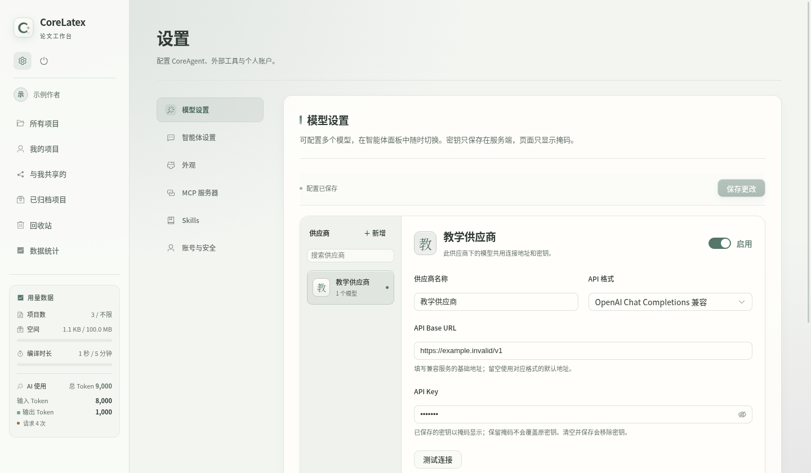
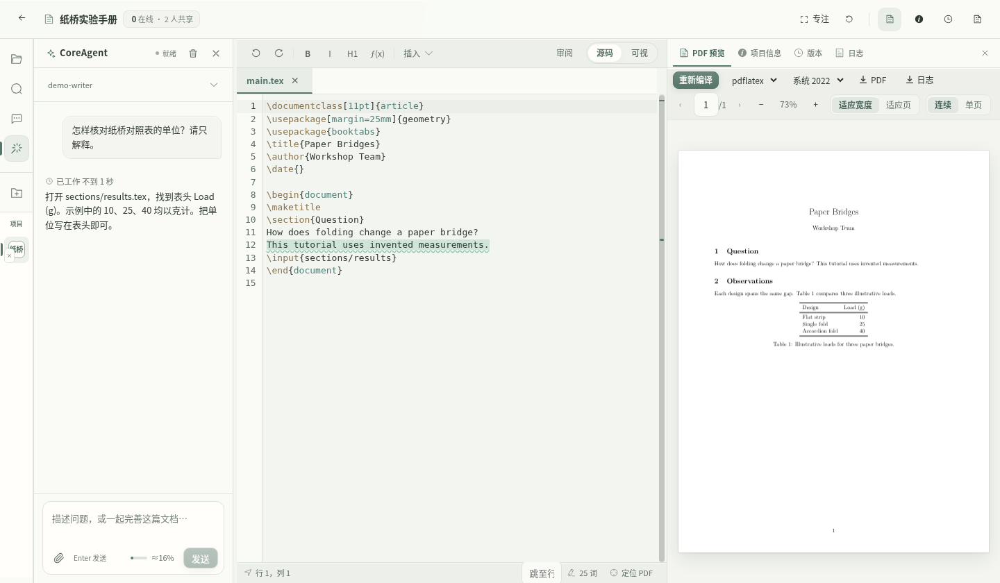
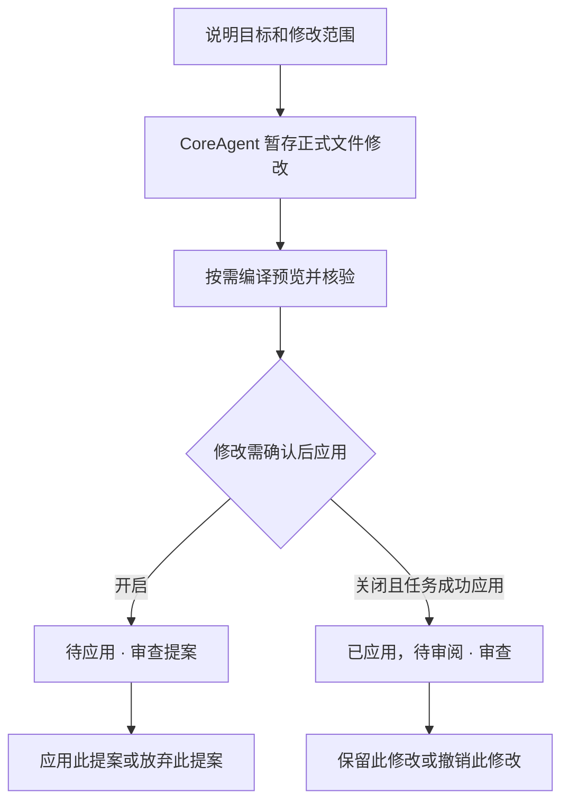
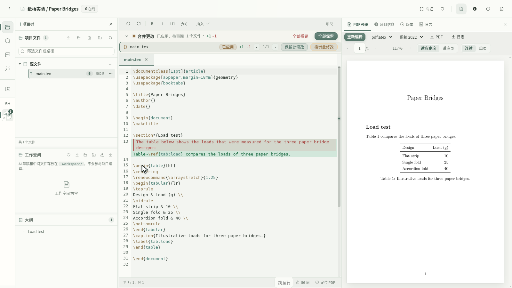
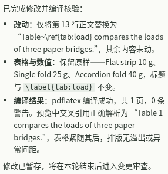
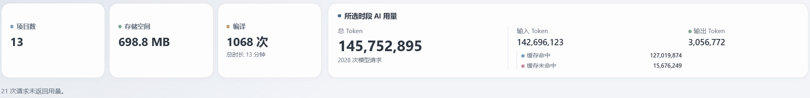
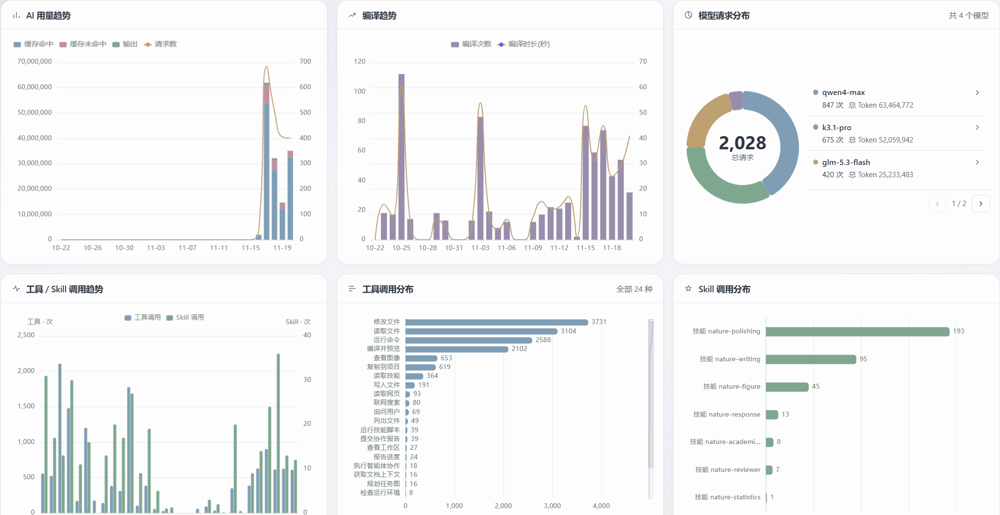

# CoreAgent、模型与用量

在项目编辑器左侧点 **CoreAgent**，可以针对当前文稿提问、改写 LaTeX、处理批注和检查排版。发起任务需要当前项目的编辑权限。首次使用时，先在项目首页点齿轮 **设置 → 模型设置**，添加一个可用模型。本章以纸桥教学稿件为例，统计图来自一个已隐去身份的真实账户。

## 配置模型

1. 在「模型设置」中点 **添加供应商**，或点供应商列表旁的 **＋ 新增**。填写便于识别的「供应商名称」，选「连接模板」，再点 **添加**。在供应商详情的 **API 格式** 中，按服务方提供的信息选 **OpenAI Chat Completions 兼容** 或 **Anthropic Messages 兼容**。
2. 填写 **API Base URL** 和 **API Key**。同一供应商下的模型共用接口格式、基础地址和密钥。Base URL 填服务方给出的基础地址，应用会拼接请求路径。留空时使用对应格式的默认地址。保存后的密钥显示为掩码，保留掩码即可沿用原密钥，清空后保存会移除密钥。
3. 点 **＋ 添加模型**。填写服务方提供的 **API 模型标识**，可另填「显示名称」用于在 CoreAgent 中辨认。按该模型的规格设置「上下文长度」和「支持图像输入」，按需要填写「Temperature（可选）」和「最大输出（可选）」。上下文长度是整个窗口的容量，最大输出限制单次生成的长度，两者均以 Token 为单位。「思考强度档位」填写服务所支持的值，移除全部档位即可隐藏该模型的强度选择。
4. 在弹窗点 **确认**，再在页面点 **保存更改**。确保供应商和模型均已启用。可点 **设为默认** 后再次保存，或回到 CoreAgent 面板，在顶部选择当前项目使用的模型。
5. 保存后点供应商的 **测试连接**，会用该供应商已保存的模型列表中的第一项发出测试请求。要检查指定模型，点该行的 **测试**。遇到认证失败时核对 API Key，遇到找不到模型或请求地址错误时核对 API 格式、Base URL 和模型标识，保存后再试。

图中的地址仅用于演示，配置时请填写模型供应商给出的地址。

CoreAgent 面板中的模型和思考强度选择按当前浏览器、账号和项目记忆，从下一轮生效。切换模型可接着原会话工作。更换供应商后，接续所需的对话内容或摘要会发送给新模型。

### 使用可选的子智能体

在 **设置 → 智能体设置** 开启 **多智能体协作** 后，可调整以下设置。此页自动保存，新的任务开始时读取当前设置。

| 界面选项 | 用法 |
| --- | --- |
| 协作档位 | **轻量 · 仅增量审阅** 检查本轮新增或改动部分。**标准 · 按需分析与核验** 还可分派分析、核验工作。**深入 · 允许并行编辑** 还允许主智能体把可独立修改的文件或互不重叠的范围交给不同子智能体。 |
| 同时请求模型的数量 | 可设为 1–8，默认 2。该设置控制同时进行的模型请求数，正在等待工具的子任务可释放模型请求名额。 |
| 子智能体模型 | 默认 **跟随主智能体**。也可指定一个已启用的模型，子智能体会用该模型所属供应商的连接配置和该模型的能力设置。 |
| 子智能体思考强度 | 跟随主智能体时，自动选项继承主模型本轮的强度。指定子模型时，自动选项使用该模型的默认档位。手动选择的档位须受实际使用的模型支持。 |

子智能体按任务需要分派。运行时在工作过程中点子任务条目，可以查看工具、进度和报告。子智能体的调查阶段有 10 分钟时限，从实际执行时起算。达到时限后进入「正在汇报」，整理已有证据、进展和未完成事项。多智能体协作关闭时，CoreAgent 仍按标准流程处理编辑和编译核验。

## 带着文稿上下文发起任务

1. 打开项目和目标文件，从左侧打开 **CoreAgent**。在代码编辑器中框选一段文字，输入框上方会显示文件名、行号和选区摘要。点提示条在 **已附带** 和 **不附带** 间切换，控制发送时是否把选区作为请求对象。若下一条消息也需引用选区，可重新框选或再次打开附带。
2. 写明目标、修改范围和需要保留的内容。当前文件的片段或光标附近的原文也可进入上下文，帮助 CoreAgent 衔接术语和论证。
3. 点 **发送** 或按 Enter。用 Shift + Enter 换行。运行中可输入文字并点 **补充**，若界面显示「等待你的回答」，则用问题卡片或输入框的 **回答** 接续当前任务。
4. 在任务下方查看工作过程。对已完成的消息，可点 **展开工作过程** 回看工具的结果和耗时。收到改稿结果后，在编辑器上方的 **合并更改** 核对实际差异。

如果只想核对内容，可以直接问「怎样核对纸桥对照表的单位？请只解释。」

要练习按选区处理多文件稿件，可导入「纸桥实验手册」。[示例项目 ZIP](examples/paper-bridges.zip?raw=true)

打开 `sections/results.tex`，选中对照表上方从 `Each design` 开始的两句，然后发送这条消息。

> 请精简选中的两句，保留三种纸桥跨距相同的条件和对照表的引用，说明载荷为虚构示例。修改仅限选中段落，改完后编译预览，确认表格引用正常。

在代码编辑器中选中文字后，也可以右键点 **翻译为中文** 或 **解释这段内容**，结果会出现在 CoreAgent 对话中。**添加中文注释**、**精简表达**、**扩写论证** 和 **优化学术表达** 会生成文件改动，随后在「合并更改」里处理。若提示选区内容已变化，按当前文档重新选择。

### 添加附件

点输入框左侧的回形针 **添加图片或文件**，也可把文件拖入 CoreAgent 面板，或将剪贴板中的截图或文件粘贴到输入框。等附件读取结束后发送。每次最多 12 个附件，其中图片最多 8 张、其他文件最多 10 个，所有附件合计最多 40 MB。PNG、JPEG、WebP、GIF 图片每张最多 5 MB，其他文件每个最多 20 MB。

发送后的附件保存于项目 **项目树 → 工作空间** 中的 `_workspace/uploads/`。支持图像输入的模型还会随本轮请求收到图片。文本模型从文字说明继续，图片可在工作空间打开。普通文件以路径提供给 CoreAgent，需要使用内容时由它读取。运行中可以补充文字，附件可在任务结束后随新消息发送。

### 使用 Skills 和 MCP

- **设置 → Skills**。点 **导入 ZIP** 或 **导入目录**，选择包含 `SKILL.md` 的资料。可以导入嵌套目录中的技能。导入后用 **查看** 核对内容，再用 **启用** 开关决定技能是否出现在 CoreAgent 的可用清单中。发起任务时，可直接写明技能名称和要执行的步骤，CoreAgent 也可按任务相关性读取已启用的技能。
- **设置 → MCP 服务器**。点 **添加服务器**，填写「名称」和「启动命令」，按行填写「参数（每行一个）」和「环境变量（KEY=VALUE，每行一个）」。应用通过 stdio 在部署端启动已配置的程序，因此命令和依赖要能在 CoreLatex 的运行环境中使用。自动保存后点 **测试 MCP 连接**，在「发现工具」列表确认所需工具已列出。显示发现 0 个工具时，先核对启动命令、参数和服务端依赖。

在「智能体设置」可用 **中文注释支持** 为改动的英文正文维护对应译注，通过 **允许联网** 和 **允许运行工作区脚本** 控制内置联网工具和脚本功能。启用「修改需确认后应用」时，CoreAgent 的工作区脚本和技能脚本会停用。外部模型会处理发送给它的提示、选区及任务所需的文件内容。使用项目允许的模型服务，并只发送本次工作所需的材料。

## 审查和处理 AI 修改

在 **设置 → 智能体设置** 中，**修改需确认后应用** 默认关闭。CoreAgent 可先在隔离副本中编译暂存稿，核对页面，再将成功完成的改动写入项目。当前打开的文件可能已自动显示行内差异，也可在 **合并更改** 点该文件的 **审查**，逐处决定保留还是撤销。希望先确认再写入正式文件时，开启上述开关。写入 `_workspace/` 的附件和中间文件即时可在「工作空间」打开。

| 「合并更改」中的状态 | 操作 |
| --- | --- |
| **已应用** | 文档已更新。点 **审查**，在编辑区查看行内差异，用 **‹** 和 **›** 跳到上一处或下一处，再点 **保留此修改** 或 **撤销此修改**。已应用的二进制文件用 **保留文件** 或 **撤销文件** 处理。 |
| **待应用** | 点该文件的 **审查提案**，对照生成时的原文和建议内容。点 **应用此提案** 写入该文件，或点 **放弃此提案** 放弃它。文件或提案在打开差异后发生变化时，重新打开「审查提案」核对最新版本。 |
| **部分待应用** | 同一文件含已写入和待应用两类修改。用 **审查已应用** 查看已写入的差异，用 **审查提案** 查看待应用的内容。 |

*红色标出原句，绿色标出改写后的句子。作者审查已写入的差异后点了「保留此修改」。*

对「合并更改」列表中的文件，顶栏的 **全部保留** 会确认已写入的修改，并应用待处理的提案。**全部撤销** 会撤回已写入的修改，并放弃待处理的提案。操作前先核对涉及的文件和提案。若显示「文档已变化，等待同步」，用 **刷新审阅** 更新差异。

如果改稿源自一条批注，可在左侧 **审阅** 面板点该批注的 **AI 修改**，把意见、原引文及最近的讨论交给 CoreAgent。核对改稿和拟定的回复后，在批注中手动 **回复**，再点 **完成**。批注已有回复时，「完成」才可用。

### 复现视频中的改稿与核验

[观看中文演示（1 分 36 秒）](../media/CoreLatex-AI-workflow-zh.mp4?raw=true)

1. 启用支持图像输入的模型并测试连接。视频中 **修改需确认后应用** 处于默认的关闭状态。[配置模型](#配置模型)
2. 新建空白项目，将原稿完整粘贴到 `main.tex`。在 **PDF 预览** 中选择 `pdflatex` 和已启用的 TeX Live 版本，点 **重新编译**，确认表格和三行载荷可见。[单文件原稿](examples/main.tex)
3. 在源码中选中从 “The table below” 开始的整句。打开 **CoreAgent**，确认选区显示 **已附带**，再发送下方的任务。

~~~text
只把选中的正文改成下面这句。
Table~\ref{tab:load} compares the loads of three paper bridges.
保留表格和数值，编译并检查结果。
~~~

任务结束后展开工作过程，确认 **编译并预览** 显示「编译成功，已读取 1 页图像」。核对 `\ref{tab:load}` 解析为 **Table 1**，表中三行载荷仍为 **10、25、40 g**，表格紧跟正文，页面没有溢出或异常间距。在 **合并更改** 中找到标为 **已应用** 的 `main.tex`，点 **审查** 查看行内差异，确认只改了所选句子后点 **保留此修改**。

### 中断、冲突与误改

| 情况 | 如何接续或恢复 |
| --- | --- |
| 切换项目或连接中断 | 切换项目或关闭工作区后，已启动的任务可以继续在后台运行。回到原项目的 **CoreAgent** 检查状态。若显示连接中断，可点 **重新连接**。想结束该任务时，点 **停止** 并等待状态更新。 |
| 发送失败或输入框还有草稿 | 未发送文字按账号、项目保存在当前浏览器标签页，刷新后通常可接续。若发送失败且输入框仍空着，原有文字和附件会回到输入框。待发送附件在当前页面运行期间切换项目时保留，刷新或关闭工作区后应检查附件列表并按需重新添加。 |
| 任务失败或已停止 | 展开工作过程，核对已经完成的步骤以及「合并更改」中出现的修改。同一账号回到同一项目的原会话，输入「继续」并指出下一步。读取、编辑和预览编译会以可接续的未应用检查点为起点。继续改动会更新对应的待审提案，等你确认后应用。 |
| 继续时提示旧草稿冲突 | 如果工作过程中出现 **下载旧草稿**，先下载，再将旧稿同当前文件对照，把需要的内容交给下一轮处理。如果提示有多个未应用提案或已有提案被审核，先在「合并更改」检查当前提案，按冲突提示处理后再继续。 |
| 误改了正式文件 | 修改仍待审时，在「合并更改」放弃提案或撤销对应修改。已确认的修改可从右侧 **版本** 查看已有快照差异，必要时点快照的 **⋯ → 恢复此版本**。恢复覆盖项目文件，系统会先为当前内容创建安全快照。 |
| 编辑器提示尚未确认保存的本地草稿 | 从编辑器提示条点 **下载恢复稿**，对照当前文档后手动合并。核对完成后点 **已恢复，清除**。 |

CoreAgent 顶部的 **清空会话** 会删除当前项目中你的会话记录并重置上下文摘要，确认后无法找回这些消息。处理文件改动请使用「合并更改」或「版本」。清空会话后仍可在「数据统计」查询已记录的用量。

## 查看数据统计与 Token

回到项目首页，点左侧 **数据统计**。普通账户查看本人的用量。管理员可切换 **全局**、**我的** 或 **用户**，选「用户」后再指定统计对象。

统计按 **北京时间（UTC+8）** 的自然日计算，范围包含今天。可选 **当天**、**近 3 天**、**近 7 天**、**近 30 天** 和 **近 90 天**，默认近 30 天。「AI 用量趋势」「编译趋势」和「工具 / Skill 调用趋势」在当天或近 3 天按小时显示，其余范围按天显示。点 **刷新统计** 可重新读取所选范围。

**视频中的账户用量。** 北京时间 2026 年 10 月 22 日至 11 月 20 日，一个真实账户发起了 **2,028 次模型请求**。其中 **21 次请求未返回用量**，其余已报告的用量合计 **145,752,895 Token**。输入为 **142,696,123 Token**，由 **127,019,874** 个缓存命中和 **15,676,249** 个缓存未命中组成。输出为 **3,056,772 Token**。同一视图的编译概览显示该账户累计 **1,068 次编译**。

### 读懂用量指标

| 界面指标 | 计算口径 |
| --- | --- |
| **模型请求** | 每次发起的模型请求尝试计一次，按请求开始时间归入所选时段。一条消息可能触发多次请求，比如模型读取工具结果后继续、子智能体工作、失败重试。模型连接测试和实际发起模型请求的历史压缩也计算在内。 |
| **缓存命中** | 供应商返回的缓存读取 Token，属于输入的一部分。 |
| **缓存未命中** | 输入 Token 减去缓存命中 Token。供应商报告的缓存写入 Token 也归入这一项。 |
| **输入 Token** | 缓存命中与缓存未命中的合计，包括本次请求使用的缓存输入。 |
| **输出 Token** | 已记录的模型输出 Token。 |
| **总 Token** | 输入 Token 加输出 Token。账单金额以模型供应商的账单为准。 |

当页面提示「请求未返回用量」时，这些请求只贡献次数。当页面提示「请求仅记录已确认的用量」时，Token 合计采用已经收到的数据。旧版按整轮保存的输入和输出仍计入 Token 合计，请求次数采用逐请求记录。旧记录缺少缓存读写明细，输入量会落在「缓存未命中」项。

### 从图表查看明细

- **所选时段 AI 用量** 汇总所选日期与统计对象的请求数和 Token。项目页侧栏「用量数据」中的「AI 使用」显示本账户的累计数据。
- **AI 用量趋势** 的堆叠柱显示缓存命中、缓存未命中、输出三个部分，折线用右轴显示请求数。悬停可查看该时点的明细。
- **模型请求分布** 的环形图按请求次数计算占比。模型列表可以展开查看 Token 明细与可识别的供应商。模型按记录的 API 模型名合并显示，有模型服务返回的名称时用该名称，否则显示请求的模型标识。同名模型由不同供应商提供时，请求可能合并到同一个模型条目。
- **编译趋势** 用柱显示次数，用右轴折线显示时长，按编译发起人计入所选范围。「编译」概览卡显示累计次数与总时长。
- **工具 / Skill 调用趋势** 分别用左右轴显示两类调用次数。「工具调用分布」按工具汇总所选时段的调用量，条目多时可滚动查看。技能分布依据读取技能的工具调用，最多展示调用次数排名前 12 的技能。一次读取技能也会计入工具调用，查看总工具调用时直接读工具系列。

*图中的「编译并预览」在所选 30 天内调用了 2,102 次。*

管理员在「全局」范围还可查看 **用户统计排行**。排行中的 AI 输入、AI 输出、AI 请求和编译次数取各用户的累计记录，编译时长列取当日已用编译时长。对于指定时段，使用上方的用量卡和趋势图。

### 上下文窗口占用

在 CoreAgent 输入框发送按钮旁点占用读数，展开 **上下文窗口**，查看 **整体占用** 及计算依据。模型服务返回的输入 Token 实测包含命中缓存的输入。带 **≈** 的百分比是预估值，任务运行时按最近一次模型请求的系统提示、工具和消息估算。任务结束后，应用按下次可回放的对话、摘要、系统提示和工具估算下一轮的占用。下轮会省去临时工具输出和旧预览图，因此占用可能下降。

新一轮任务开始时，CoreAgent 会检查历史对话占用，必要时把较早的对话整理成摘要。会话空闲时也可点 **压缩上下文** 手动整理，原消息仍可在聊天记录中查看。生成摘要的模型用量计入「数据统计」。
