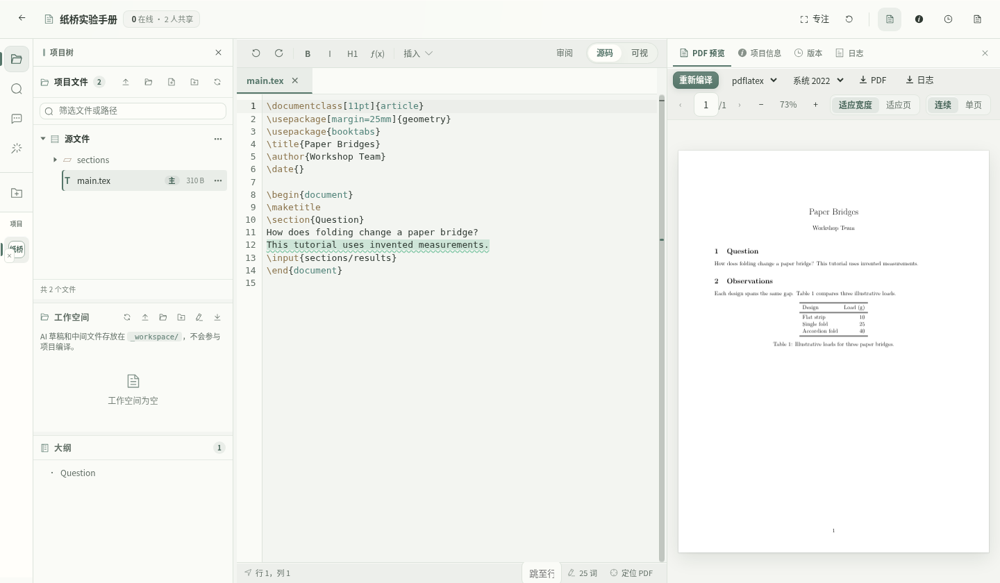
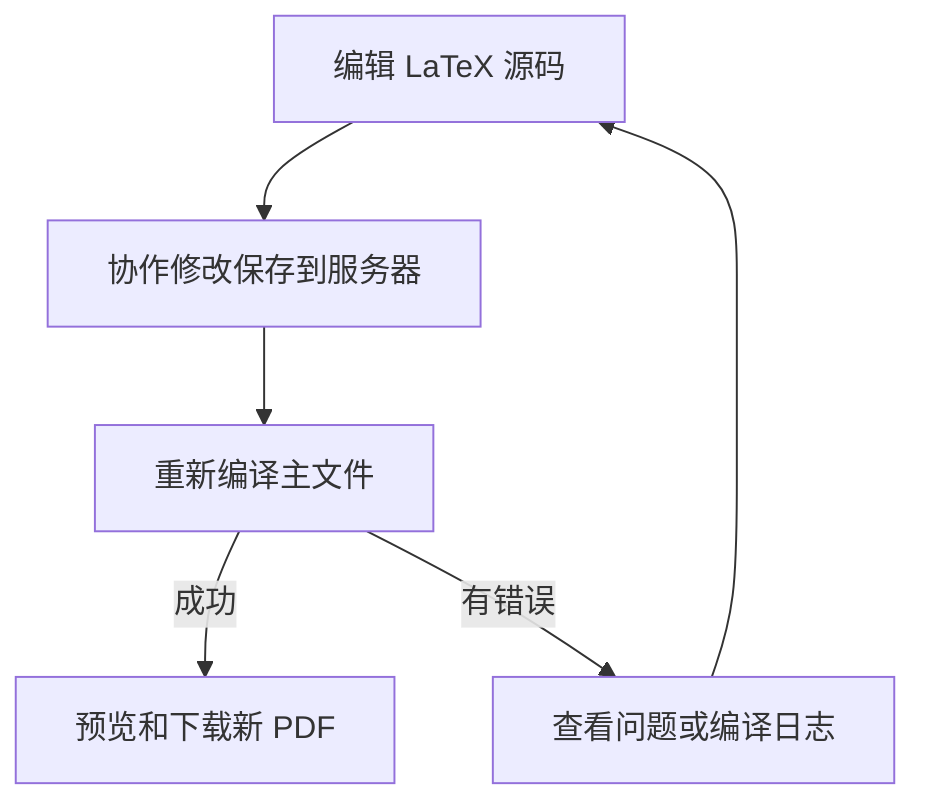
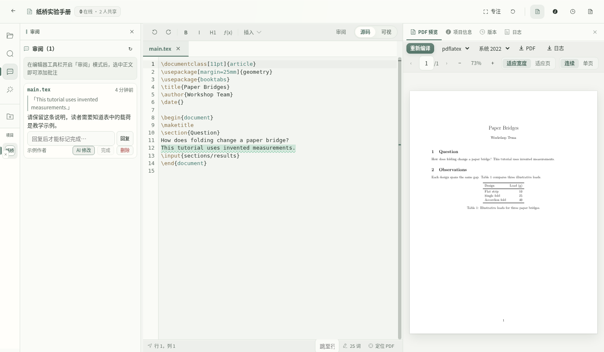

# 项目协作与 LaTeX 编译

本章使用教学虚构项目「纸桥实验手册」，主文稿为 `main.tex`，结果章节为 `sections/results.tex`。下载多文件练习项目，跟随下面的步骤生成标题为 *Paper Bridges* 的 PDF。[下载示例 ZIP](examples/paper-bridges.zip?raw=true)

## 新建、导入与导出项目

1. 登录后，在项目列表右上角点 **新建项目**。
2. 从头写作时，填写 **项目名称**，点 **空白创建**。系统生成带有文档结构的 `main.tex`。如果项目名含中文，而你想用默认的 `pdflatex` 试跑模板，可以先将 `\title{…}` 中的标题改为 `Paper Bridges`。
3. 导入已有项目时，在同一个弹窗点 **上传 ZIP**，选择 `paper-bridges.zip`。可在选择文件前把 **项目名称** 填为「纸桥实验手册」，也可留空使用 ZIP 文件名。压缩包可以包含章节、图片、文献库和样式文件。把编译入口放在压缩包的项目根目录，并命名为 `main.tex`，便于导入后直接编译。
4. 创建或导入后，在 **我的项目** 里点击项目名称进入编辑器。可以用 **搜索项目** 按名称找到它。

在项目列表行尾点 **⋯ → 导出 ZIP**，下载正式项目文件，如 `.tex`、`.bib` 和图稿。编译好的成品通过 PDF 工具栏上的 **PDF** 下载。成员、批注和版本历史在原项目中查看。

## 管理项目文件

在编辑器左侧点 **项目树**，打开 **项目文件**。点文件名会在中央打开标签。将鼠标移到文件区顶栏图标上，可以查看操作名称。

| 要做的事 | 操作 |
| --- | --- |
| 新建结果章节 | 点 **新建文件**，在 **目录** 填 `sections`，**文件名** 填 `results`，**类型** 选 `.tex`，点 **创建**。在 `main.tex` 的 `\end{document}` 前加入 `\input{sections/results}`，即可把该章节纳入编译。使用示例 ZIP 时，这两个文件及其引用已经具备。 |
| 创建文件夹和上传 | 点 **新建文件夹** 并输入项目内的相对路径，或用 **上传文件** 多选文件。用 **上传目录** 保留子目录结构。在目标目录的 **⋯** 菜单选择 **上传文件到此处** 或 **上传目录到此处**，可直接上传到指定位置。同路径上传会覆盖原文件。 |
| 筛选、下载或重命名 | 在 **筛选文件或路径** 中输入名称或路径。点文件旁的 **⋯**，选择 **下载文件** 或 **重命名**。移动或改名后，检查 `\input`、`\includegraphics` 和文献库等引用是否仍指向正确位置。 |
| 移动或删除 | 拖到实际文件夹上可移入该目录。可用 `Shift` 连选，或用 `Ctrl`（macOS 为 `⌘`）逐项选中，再批量移动或点 **批量删除**。单项使用 **⋯ → 删除**。删除文件夹会一并删除里面的文件，需要留存时先创建版本快照。 |
| 更换编译入口 | 拥有者在目标 `.tex` 文件的 **⋯** 菜单选择 **设为主文件**。当前入口带有 **主** 标记。选包含 `\documentclass` 与完整文档结构的文件，例如示例中的 `main.tex`。 |

## 共享、归档与回收站

拥有者在项目列表点 **⋯ → 共享**。在 **按用户名添加成员** 下输入对方已经注册的用户名，选 **可编辑** 或 **只读**，再点 **添加**。对方登录后可从 **与我共享的** 打开项目。需要调整角色时，用同一用户名选择新角色后再点 **添加**。需要收回访问权限时，在成员行点 **移除**。

| 项目角色 | 可以进行的主要操作 |
| --- | --- |
| 拥有者 | 管理共享、项目名称、主文件和回收站，也可编辑、审阅、编译及恢复版本。 |
| 可编辑 | 在未归档项目中协作编辑、管理文件、提交和回复批注、创建及恢复版本。可以更改编译设置、发起编译、归档或取消归档。 |
| 只读 | 查看和下载项目文件及已有 PDF，查看编译日志和版本记录。在未归档项目中可查看已有批注。 |

阶段工作结束时，拥有者或可编辑成员可在项目列表点 **⋯ → 归档**。归档项目在 **已归档项目** 中以只读方式打开，拥有者和可编辑成员仍可重新编译。要继续修改文件，到 **已归档项目 → ⋯ → 取消归档**。

拥有者点 **⋯ → 删除 → 移入回收站** 后，可在 **回收站 → ⋯ → 恢复** 找回项目。**彻底删除** 会永久清除项目。要找回项目内误删的文件，可以查看删除前的版本快照。快照恢复以整个项目的文件为单位。

## 编辑与多人协作

- **左侧**的 **项目树** 为 `main.tex` 标出 **主**。点文件名可切换文件，从 **大纲** 点章节标题可在当前文件中跳转。找文稿中的字句时，点 **文件搜索**，选择 **当前文件** 或 **全项目**，输入文字后点搜索结果跳转。
- **中央**的 **源码** 区打开了 `main.tex`，其中 `\input{sections/results}` 引入了结果章节。选中文字可用工具栏加粗、添加章节或插入公式，更多选项在 **插入** 中。支持 **可视** 的文件可切换到只读预览，继续写作时切回 **源码**。底部 **跳至行** 输入行号后按回车即可定位。
- **右侧**显示 *Paper Bridges* 的编译结果。通过顶栏 **PDF 预览**、**版本** 或 **日志** 图标可切换面板。需要同时打开多个项目时，点左侧靠下的 **打开或切换项目**，搜索后在左侧的项目标签间切换。

拥有编辑权限的成员打开同一项目和同一文件即可共同写作。顶栏显示在线人数及协作者头像，编辑区可看到其他人的光标和选区。协作连接正常时，文字改动会自动同步和保存。`Ctrl+S` 或 `⌘+S` 会触发重新编译，编译会等当前协作修改保存后开始。

### 处理断线与本地恢复稿

短暂断线时，保留页面并等待自动重连。普通重连会补送尚未确认的修改。若提示 **协同服务暂时不可用** 或内容处于只读，先检查网络并等连接恢复，再继续编辑。若提示文件已移动或访问权限失效，请重新打开正确文件，或联系项目拥有者核对共享权限。

如果服务端重建了协作文档，编辑器可能提示 **有尚未确认保存的本地草稿，可下载核对**。打开原文件后按以下顺序处理。

1. 按时间选择一份草稿，点 **下载恢复稿**。如果提示恢复稿暂存于内存，先下载，再刷新或关闭页面。
2. 等文件同步后，将下载的草稿与当前 **源码** 对照。把确实缺少的段落手动合入，保留其他协作者已经提交的修改。
3. 确认内容齐全后，点 **已恢复，清除**。恢复稿保存在原浏览器中，与登录账号、项目和文件关联。

## 编译、查看 PDF 与双向定位

1. 在 **项目文件** 确认 **主** 标记位于 `main.tex`，然后从顶栏打开 **PDF 预览**。
2. 选择 **编译引擎** 和 **TeX Live 版本**。示例使用可用的 `pdflatex` 即可。包含 `fontspec` 的文稿请选择 `xelatex` 或 `lualatex` 中与模板匹配的引擎。新项目默认选择 TeX Live 2024，原有项目可能显示系统 TeX Live。可选择的版本由管理员安装或启用。每次选择成功后即保存到项目，后续编译沿用该设置。
3. 点 **重新编译**。首次成功后，右侧显示 PDF。用 **适应宽度** 或 **适应页** 缩放，用 **连续** 或 **单页** 切换浏览方式。输入页码后按回车可跳页。点工具栏上的 **PDF** 下载预览中的成品。

PDF 工具栏下方会显示编译错误和警告。点带文件与行号的问题可跳回源码。优先处理靠前的错误，再重新编译。点顶栏 **日志** 查看编译历史和某次任务的完整输出，也可点 PDF 工具栏上的 **日志** 下载日志文件。有过成功编译时，失败的这一轮仍可能显示上一份 PDF，请结合错误提示判断。

**用 SyncTeX 在源码与 PDF 之间跳转**

- 源码到 PDF。在源码中把光标放到已排版的正文，点编辑器底部的 **定位 PDF**。也可在源码中选择文字后右键点 **定位到 PDF**。
- PDF 到源码。在当前 PDF 的正文处双击，编辑器会打开对应文件并跳到相应行。定位依赖这份 PDF 对应的编译结果。修改了正文或入口后，先重新编译再定位。

## 版本快照和团队批注

### 建立快照、查看差异、恢复项目

1. 点击顶栏的 **版本**。重大改动前可点 **手动创建快照**，填写 **版本说明**，例如 `完成载荷测试小节`，再点 **创建**。正常编译成功且内容较上一份快照有变化时，也会生成 **自动快照（编译）**。
2. 点一条版本记录，展开变更文件列表。点某个文件的 **查看**，或从该版本的 **⋯ → 查看更改** 打开全部文件的差异。差异相对上一份快照，首份快照显示初始内容。文本文件显示逐行差异，图片和 PDF 等文件显示变更类型和 **二进制** 标记。
3. 确认要回退整个项目时，在目标版本的 **⋯ → 恢复此版本** 检查版本号，再点 **恢复**。系统先保存当前内容为安全快照，再用选中的版本恢复文件。多人同时写作时，可先和协作者确认时机。如果提示恢复期间有新的编辑，查看这些改动后再试。恢复成功后重新编译，生成对应版本的 PDF。

### 添加、回复并完成批注

1. 具有编辑权限的成员打开待审 `.tex`，点击中央工具栏的 **审阅**。此时编辑区进入只读选文状态。
2. 选中一句或一段，点选区旁的 **添加批注**，也可以右键选择同名操作。写清具体建议，例如「请在载荷结果前说明测量单位」，再点 **提交**。
3. 从左侧 **审阅** 面板点击批注卡片，可跳转到关联文件和原文位置。其他编辑者可以用 **回复** 记录处理意见。批注至少有一条回复后，才可点 **完成**。完成的批注列在 **已完成**，仍可点开定位。作者可以单独删除自己的批注，或用 **清空已完成** 清理自己的已完成项。
4. 需要修改文稿时，再点中央工具栏的 **审阅** 退出该模式。

图中左侧批注卡引用了 `main.tex` 的一句话，中间的波浪线标出这句原文。配置好模型后，可在卡片点 **AI 修改**，让 CoreAgent 根据批注和回复修订文稿并拟一条回复建议。在 **合并更改** 中核对实际差异。已应用的改动可保留或撤销，待应用的提案可应用或放弃。采用回复建议时，回到批注卡片提交 **回复**。[审查和处理 AI 修改](coreagent-and-usage.md#审查和处理-ai-修改)

## 常见问题

| 看到的问题 | 处理办法 |
| --- | --- |
| 导入后提示找不到主文件，或编译进入了错误章节 | 请拥有者找到包含完整文档结构的 `.tex`，点 **⋯ → 设为主文件**，检查 **主** 标记再编译。ZIP 的编译入口可放在项目根目录并命名为 `main.tex`。 |
| 共享后无法编辑或编译 | 顶栏显示 **只读成员** 时，请拥有者检查你的角色。显示 **已归档（只读）** 时，可编辑成员仍可编译，继续写作请先取消归档。若只有正文区域无法输入，检查 **审阅** 模式、**可视** 预览和协作连接提示。 |
| TeX Live 显示 **暂不可用**，或日志报缺字体、`.sty` | 记录所选 TeX Live 年份、引擎和第一条报错。若模板支持，可切换到已可用的版本。需要特定年度、字体或宏包时，联系管理员在 **设置 → 运行环境** 中安装或启用。 |
| 引用或图稿找不到 | 检查日志里给出的文件名，并对照项目树确认相对路径、大小写及后缀。文献引用还需确认 `.bib` 已上传、引用键与文献库中的条目一致。 |
| 能看到 PDF，但文字仍是旧的，或定位不到新段落 | 查看上一次编译结果并处理错误。确认协作编辑保存后重新编译，待新 PDF 加载完再定位。编译成功但浏览器把某页显示为空白时，可以下载 PDF 检查该页。 |
| 提示项目数量、存储空间或今日编译时长已达上限 | 回到项目列表，查看左侧 **用量数据**。项目数量或存储不足时，核对用量并联系管理员。今日编译时长用完后，可次日再试，或请管理员补充当日额度。 |
