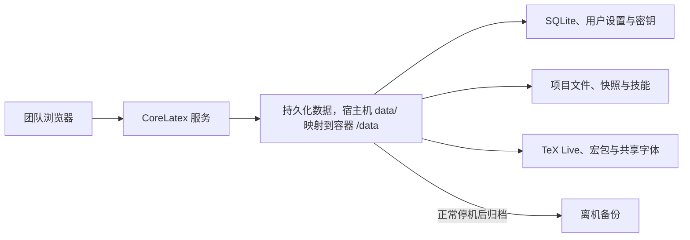

# 安装与管理员指南

CoreLatex 采用 [MIT 许可证](../LICENSE)，支持个人、团队和企业自行部署。应用和 SQLite 可以部署在同一台机器，下面的命令以 Linux 和 Bash 为例。

## 用 Docker Compose 安装

在 Linux x86-64（amd64）主机准备 Docker Engine 和 Compose v2。在仓库的 **Code** 菜单复制克隆地址，或选择 **Download ZIP** 并解压。进入包含 `Dockerfile` 和 `docker-compose.yml` 的源码根目录。构建时需要能访问基础镜像、npm 和 Debian 软件源，Dockerfile 会尝试使用 `mirrors.aliyun.com` 安装 Debian 软件包。为 TeX Live 及项目文件留出磁盘空间。

克隆和 GitHub 的源码 ZIP 均包含以下构建文件。请保留这些路径。

| 路径 | 用途 |
| --- | --- |
| `docker/bins/better_sqlite3.node` | 随源码提供的 Linux x86-64 原生模块，Dockerfile 用它覆盖镜像内构建的 SQLite 扩展。可用 `file docker/bins/better_sqlite3.node` 查看架构。 |
| `docker/texlive-local/texmf/tex/latex/ieeeconf/ieeeconf.cls` | Dockerfile 将整个 `docker/texlive-local/texmf/` 复制进系统 TeX 树，供采用小写 `ieeeconf` 文档类的模板使用。 |
| `server/package-lock.json`、`web/package-lock.json` | 镜像构建用 `npm ci` 按锁文件安装依赖。 |

Linux arm64 主机请使用[裸机安装](#直接在-linux-上运行)，由 npm 在目标环境安装原生扩展。Dockerfile 固定 Node.js 24.19.0，并在构建时检查 SQLite 读写。调整 Node 或 SQLite 扩展版本时需要一起验证。

Compose 默认将端口映射为 `3333:3333`。可以在可信内网完成初始化，也可以把 `services.corelatex.ports` 中的映射设为 `"127.0.0.1:3333:3333"`，仅从宿主机本地访问。先限制可以访问的人，再登记首个管理员。默认容器用户是 `1000:1000`，数据目录必须对这个用户可写。全新安装时执行以下命令。

~~~bash
mkdir -p data
sudo chown 1000:1000 data
sudo chmod 700 data
docker compose up -d --build corelatex
docker compose ps
docker compose logs --tail 80 corelatex
~~~

重复运行 `docker compose ps`，等容器状态显示为 `healthy`。用 `curl -fsS http://127.0.0.1:3333/api/health` 检查服务，再访问 <http://127.0.0.1:3333>。浏览器在另一台机器上时，可以通过 SSH 端口转发访问服务器的本地端口。完成建号后，再向团队开放可信内网或使用 HTTPS 反向代理。代理应转发 `/collab` 的 WebSocket 升级请求，并对 AI 的 SSE 响应关闭缓冲，使事件能及时送到浏览器。若主机端口已占用，只修改映射左侧的主机端口，容器内继续使用 3333。

## 直接在 Linux 上运行

以 Debian 为例安装基础依赖。TeX Live 提供编译引擎和 SyncTeX，Poppler 用于处理 PDF，Python 和 Matplotlib 用于智能体绘图。受管 TeX、宏包和字体安装使用 `flock`。根据论文模板按需追加宏包或字体。

~~~bash
sudo apt-get update
sudo apt-get install -y build-essential ca-certificates python3 \
  python3-matplotlib python3-numpy fontconfig fonts-noto-cjk \
  perl tar xz-utils wget util-linux poppler-utils \
  texlive-latex-base texlive-latex-recommended texlive-latex-extra \
  texlive-xetex texlive-luatex texlive-lang-chinese biber latexmk
~~~

使用已有的 nvm 或其他 Node 版本管理器，在源码根目录安装依赖并构建前端。

~~~bash
nvm install 24.19.0
nvm use 24.19.0
npm --prefix server ci
npm --prefix web ci
npm run build
npm start
~~~

浏览器访问 <http://127.0.0.1:3333>。长期运行时，用进程管理器以专用普通用户启动，并固定 Node 路径和数据目录。裸机默认监听 `127.0.0.1:3333`，数据写入源码根目录的 `data/`。可通过 `HOST`、`PORT` 和 `CORELATEX_DATA_DIR` 调整。为每个数据目录运行一个应用实例，确保应用用户可读写。`.env` 可供 Compose 插值，裸机部署应在启动环境或进程管理器中设置变量。 [配置和开发命令](technical-reference.md)

## 首次注册与团队账号

1. 打开登录页的 **注册** 标签，填入用户名、昵称和密码。用户名允许 2–32 位英文字母、数字或符号 `_`、`.`、`-`，请为管理员使用独立的强密码。提交后会自动登录。空数据库中的首个账号成为唯一管理员。
2. 在项目首页左上角打开 **设置 → 系统设置**，按团队需要设置 **允许新用户注册**，点击 **保存系统设置**。默认允许自助注册。关闭后，管理员仍可从左上角的 **用户管理 → 新建用户** 创建普通账号。
3. 在 **系统设置** 中设置默认存储与编译时长。初始默认值是 100 MB 和 300 秒/天，项目数默认不限。更改存储或编译默认值也会更新未单独定制配额的普通账号。
4. 在 **用户管理** 的用户行点击 **编辑配额**，可以设置项目数、每日编译秒数和存储空间，单项填 `-1` 代表不限。多选用户后可 **批量设置配额**。编译额度按 UTC 日期计算，**补充今日额度** 为有正数基础额度的账号追加一份当日基础额度，保留已用时长。账号行还提供 **重置密码** 和普通账号的启用、禁用操作。

需要使用 AI 时，在 **设置 → 模型设置** 添加 OpenAI 兼容或 Anthropic 兼容供应商，填写 API Base URL、API Key 和模型标识，启用模型，点 **保存更改** 后再点 **测试连接**。每个账号可单独配置模型。应用服务器需要能访问模型服务。 [配置模型](coreagent-and-usage.md#配置模型) · [配置自建 SearXNG](technical-reference.md#联网搜索后端)

## 安装 TeX Live、宏包与字体

用管理员账号打开 **设置 → 运行环境**。项目所选的 TeX Live 年份与编译引擎是两项独立设置。

| 要做什么 | 界面操作 |
| --- | --- |
| 安装新项目的默认版本 | 在 **TeX Live 版本** 找到 2024，点 **安装**，等 **安装记录** 显示成功并确认可用。界面支持 2022–2026，能在 Linux x64 或 arm64 自动下载安装。 |
| 使用已有安装 | 展开该年份的 **已有安装**，填写编译器 `bin` 目录的绝对路径并点 **保存并检测**。探测成功后会启用该版本。Docker 中填写容器内路径，并持久挂载整套 TeX Live。 |
| 调整下载源 | 在 **下载镜像** 中每行填写一个 HTTPS 地址，应用按顺序尝试。历史年度镜像必须包含独立的 `{year}` 路径段，以便选择对应年份的冻结仓库。 |
| 安装宏包 | 在 **安装 LaTeX 宏包** 选择已启用的受管版本，填写包名，例如 `booktabs, siunitx`，点 **安装宏包**。系统 TeX 的包由操作系统维护，外部挂载的 TeX 由该安装的管理员维护。 |
| 安装共享字体 | 在 **系统字体** 点 **安装字体**，上传 TTF、OTF 或 TTC，每批最多 12 个，每个最多 30 MB。用界面搜索字体家族名称。XeLaTeX、LuaLaTeX 和应用启动的 Python 绘图进程可共享这些字体。 |

安装完成后，点 **新建项目**，填写名称并点 **空白创建**。从项目列表打开新项目，在 **PDF 预览** 工具栏选择年度和引擎，再点 **重新编译**。已有项目可继续使用此前选定的 **系统 TeX Live（兼容）**。要在年度版本安装前验证系统 TeX，可在 PDF 面板手动选中系统版本。编译器无法使用时会提示错误，需要安装、启用或调整所选版本。 [首次编译示例](editing-and-compilation.md#编译查看-pdf-与双向定位)

## 备份、恢复与升级

备份整个持久化目录。由界面安装的 TeX Live、共享字体和安装记录在 `data/runtime/`。外部挂载的 TeX 目录、代理配置、私有环境文件与 Compose 覆盖文件应一并纳入运维备份。备份含用户数据和密钥，存放在有访问控制的独立位置。下列步骤假定使用 Compose 默认的 `./data:/data`。

### 进入维护并备份

1. 安排维护窗口，通知用户保存并关闭编辑页，暂时限制团队入口。确认 **安装记录** 没有正在运行的环境安装。用 `/api/health` 确认 `maintenanceProtocol: 1`，然后检查工作状态、获取维护门禁。

   ~~~bash
   owner="/data/.corelatex-maintenance-$(date -u +%Y%m%dT%H%M%SZ)"
   docker compose exec -T corelatex node /app/scripts/maintenance.js status
   docker compose exec -T corelatex node /app/scripts/maintenance.js acquire --owner-file "$owner"
   ~~~

   若有任务在运行，等已有编译或智能体任务结束后再试。凭据文件由命令生成，模式为 0600，保留路径变量供同一次维护使用。默认门禁有效 15 分钟，停机前如需延长，用同一凭据执行 `renew --owner-file "$owner"`。升级自缺少维护协议的旧版时，先隔离用户入口，确认用户已保存、退出协作和结束任务，再按该版本支持的流程正常停机。此时用入口隔离覆盖整个维护窗口。

2. 让应用处理 SIGTERM 并保存协作内容。等状态为 `exited 0` 再归档。若退出阻塞，在另一终端检查日志和磁盘权限，待问题解决后继续。`--timeout -1` 会等待进程自行退出。 [Docker 停机说明](https://docs.docker.com/reference/cli/docker/container/stop/#stop-container-with-timeout--t---timeout)

   ~~~bash
   container_id="$(docker compose ps -q corelatex)"
   docker container stop --signal SIGTERM --timeout -1 "$container_id"
   docker inspect --format '{{.State.Status}} {{.State.ExitCode}}' "$container_id"
   ~~~

3. 备份全部数据，排除本次维护凭据，并验证归档可以读取。以下命令在源码根目录运行。每一步成功后再继续。

   ~~~bash
   umask 077
   backup_dir="$HOME/corelatex-backups"
   mkdir -p "$backup_dir"
   backup_name="data-$(date -u +%Y%m%dT%H%M%SZ).tar.gz"
   archive="$backup_dir/$backup_name"
   sudo tar --numeric-owner --exclude='data/.corelatex-maintenance-*' -czf - data > "$archive"
   tar -tzf "$archive" >/dev/null
   (cd "$backup_dir" && sha256sum "$backup_name" > "$backup_name.sha256")
   ~~~

4. 仅备份时，执行 `docker compose start corelatex` 启动原容器。升级时按下一节启动新容器。确认 `/api/health` 返回 `ok: true` 和 `shuttingDown: false` 后，如本次获取过门禁，用同一凭据解除，再删除凭据文件。备份或升级验证期间仍限制团队入口。

   ~~~bash
   docker compose exec -T corelatex node /app/scripts/maintenance.js release --owner-file "$owner" &&
     docker compose exec -T corelatex rm -f -- "$owner"
   ~~~

### 升级与恢复

升级前记录当前 Git 版本，备份部署配置，并给运行中的镜像添加回退标签。

~~~bash
container_id="$(docker compose ps -q corelatex)"
old_image="$(docker inspect --format '{{.Image}}' "$container_id")"
docker image tag "$old_image" corelatex:rollback-local
~~~

用新版源码提前执行 `docker compose build corelatex`。按上面的维护步骤停机并验证备份，再执行 `docker compose up -d --no-build --pull never corelatex`。沿用现有的 Compose 项目名、部署配置和数据挂载。换源码目录时，用相同的项目名并将原数据目录以宿主机绝对路径挂入新容器。检查 `docker compose ps` 和 `/api/health` 后按上述步骤解除门禁，再用测试项目验证登录、编辑和 PDF 编译，最后恢复团队入口。裸机升级同样先准备新版依赖和前端产物，确认任务结束、正常停机并验证数据备份，再以原数据目录启动新版。

恢复前，把 `backup_dir`、`backup_name` 和 `archive` 分别设为备份目录、归档文件名及完整路径。在宿主机安装 SQLite 命令行工具（Debian 可运行 `sudo apt-get install sqlite3`），在独立目录验证备份。[SQLite 命令行说明](https://sqlite.org/cli.html)

~~~bash
(cd "$backup_dir" && sha256sum -c "$backup_name.sha256")
restore_dir="$(mktemp -d "$backup_dir/restore.XXXXXXXX")"
sudo tar --numeric-owner -xzf "$archive" -C "$restore_dir"
sudo sqlite3 -readonly "$restore_dir/data/corelatex.db" 'PRAGMA quick_check;'
~~~

数据库检查预期输出 `ok`。确认所有者、写权限及外部挂载后，将目标服务的数据挂载指向恢复目录内的 `data/`。回退时使用升级前的完整备份，并保留升级后的数据目录供核查。Docker 可在旧 Compose 配置中将 `services.corelatex.image` 指向 `corelatex:rollback-local`，再用 `docker compose up -d --no-build --pull never corelatex` 启动。备份数据库可能记录尚未过期的维护门禁，恢复后可等待它到期再测试新编译。

## 常见故障

| 现象 | 检查方法 |
| --- | --- |
| 构建时提示 `COPY` 文件找不到 | 核对源码根目录、上述构建文件及 `.dockerignore`。若 `better_sqlite3.node` 报 ELF 或原生模块错误，核对镜像是否为 Linux amd64，并检查锁文件与 Node 版本。 |
| 容器反复重启、提示数据库只读或无法打开 | 看 `docker compose logs --tail 100 corelatex`。核对宿主机数据目录、可用磁盘空间、容器用户和已有数据的所有者。若升级后出现空项目列表，检查是否挂到了新建的空 `data/`。 |
| 首页正常，TeX 2024 显示暂不可用 | 新项目需要安装或配置 2024。检查该年份是否启用，以及容器到下载镜像的 HTTPS 连通性。安装失败可在 **安装记录** 查看原因，调整镜像后重试。 |
| 编译提示缺宏包、找不到字体或没有配额 | 查看 PDF 面板的 **日志**，核对当前 TeX 年度与编译引擎。把宏包装到实际选中的受管版本，按字体家族名称引用共享字体。若是配额提示，在 **用户管理** 处理该账号的当日额度。 |
| AI 会话显示鉴权失败、断流或协作一直离线 | 鉴权失败先在 **模型设置** 校验密钥、API Base URL 与模型标识。反向代理入口异常时，检查 SSE 缓冲与 `/collab` WebSocket 转发。当日志出现 SQLite 原生扩展析构断言时，核对镜像中经验证的模块和固定 Node 版本。 |
