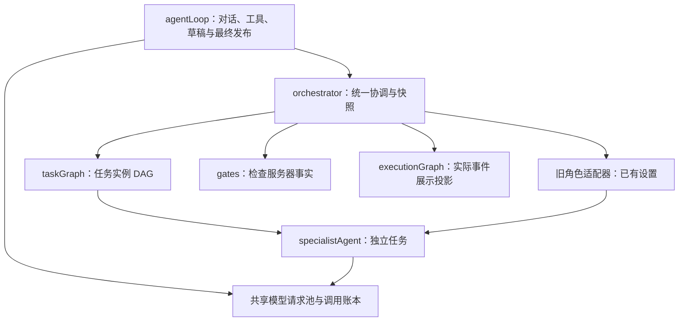

# 智能体编排运行时

本次改造针对重复调查、粗粒度审阅失效、无效返工和调用消耗不可追踪的问题。它保留现有草稿、权限、编译缓存和最终答复发布检查，不把模型报告当成写入授权。

## 入口与兼容

设置中的协作开关仍可关闭独立 worker。新选择的档位使用任务实例调度；已有 `graphOrchestration: true` 且没有 `collaborationTier` 的设置保留旧角色适配器，避免升级时改变已保存偏好。新旧运行都输出 v4 展示快照，前端同时支持 v1–v3 历史记录。

| 设置 | 行为 |
| --- | --- |
| `collaborationTier: off` | 主智能体处理；编译、来源和声明检查继续生效 |
| `lite` | 仅按净变更派发增量 reviewer |
| `full` | 按需分析、查证、增量审阅与验证；没有并行编辑能力 |
| `deep` | full 的能力，加现有服务器冻结范围的并行编辑批次 |
| `maxModelConcurrency` | 每轮共享的实际模型请求并发，默认 2，范围 1–8；等待工具与重试退避不占该槽 |
| `orchestrationBudgetUsd` | 可选的请求预留策略，默认关闭；必须有可信模型价格，未知价格拒绝准入 |

当前 `toPiModel` 没有提供可信价格，因此账本费用显示未知。费用上限接口不能当成已经完成的计费系统，UI 暂不提供此项开关。发生失败且用量不明的请求不会被计为免费。

编译源码错误默认自动修复并重新验证，不提供修复次数设置，也不设固定次数上限。旧 `repairCycles`（包括 0）不再影响运行，设置读取时忽略、下次保存时移除；权限、草稿确认和用户明确的只读要求保持有效。

## 任务、报告与证据

`plan_task_graph` 支持 `tasks`：每项包含 `taskId`、`archetype`、`objective`、`readScope` 和 `dependsOn`。同类任务可以有多个实例。`usable_report` 允许下游消费带问题的分析，`pass` 要求上游通过；不能删除或替换未解决的必要任务来绕过交付。`tasks` 与旧 `agents/assignments` 互斥。

实例 DAG 目前开放 analyst、researcher、reviewer、verifier。编辑仍通过 `run_parallel_edits` 的服务器私有会话、冻结范围和原子合并执行，没有开放模型自定义 editor 权限或任意 `merged_draft` 依赖。任意 DAG 编辑器是后续扩展接口，不应通过增加角色枚举直接开放。

上下文包包含真实用户要求及出处、作用范围、执行事实与实际返回的原文窗口。窗口只有在内容哈希仍匹配时才注入；全文哈希不会把局部读取扩大为全文覆盖。每个窗口明确起止行及截断状态，不为每个 worker 额外调用摘要模型。

报告保存 reportId、attemptId、findingId、goalVersion、快照、核查范围、限制和依赖清单。blocked 即使没有 findings 也保留原因。报告与原文都是参考数据，不能改变任务或权限。报告只能证明它所说明的范围，服务器引用校验不保证语义判断正确。

精细复用检查本轮差异、真实读取及上游传递的依赖哈希。资料改变也会使没有 findings 的 pass 失效；未完整追踪的外部依赖不跨版本复用。新增净变更必须补足整体审阅覆盖。编译继续使用已有的项目、动态依赖和运行环境指纹，不能按文件后缀跳过失效检查。

可选 `suggestedFix` 必须定位到本次冻结草稿：同一文件、正确 baseHash、唯一 search。它不会自动执行。采用建议时通过原 `edit_file` 提交 baseHash 和 fixAppliedFor，仍需先读后改、权限检查与后续复核；fixAppliedFor 只是关联记录，不是通过证明。

## 消耗与恢复

每轮 `workflow.graph.accounting` 保存实际模型请求的 owner、phase、模型、排队/开始/结束时间、返回用量、费用已知与未知情况，以及共享请求池和修复记录。正常创建消息的运行包括历史压缩、主模型、worker、汇报和连接重试。主模型 token 统计使用此账本聚合，避免漏掉已返回用量的失败重试；现有 ai_usage 表仍保留每轮聚合口径，分模型分析应读取请求账本。

上下文准备发生在消息建立前；若准备失败并导致原请求回滚，尚无持久化的 workflow 消息，因此不应把 workflow 账本解释为跨全部失败入口的财务审计日志。最终费用应与提供商账单核对。

修复周期只用于观测，一次问题反馈后的多文件修复计一个周期，不以次数阻断后续有效修改。相同问题与相关输入再次出现时停止无进展返工，改变无关文件或 taskId 不能绕过检查。报告格式纠正、连接重试、交付补充请求和修复周期有独立语义。旧配置保留原有最多 2 次交付补充机会，新显式档位为全局最多 3 次，不再按多个控制器叠加。

单智能体和多智能体遇到真实编译源码错误时，默认核对最新源码与诊断、修改、重新编译；无需先设置次数或逐次询问用户。用户仅要求诊断、禁止修改或停止时优先遵守。失败修改、同内容写入、普通首次编辑不计修复周期；编译限额、服务不可用和预览失败不能冒充正文错误。相同输入再次请求已失败的编译会停止空转；文件、编译设置或受追踪环境变化后才能重新验证。没有可信输入指纹时不会伪造“输入相同”的判断。新快照的 `accounting.repair.mode` 为 `automatic`、`limit` 为 `null`，`used` 继续记录实际修复周期。

本轮确定性编辑错误按工具参数、相关文件的真实哈希和实际读取范围记录；相同条件再次失败会进入受阻交接。重新读取仍真实执行，文件内容变化或参数纠正后可继续；网络、脚本、外部工具的不确定副作用不采用此缓存。`accounting.toolRecovery` 记录该保护的命中次数。

## 单智能体与文件新鲜度

重复读取不是错误。用户修改、撤销、删除文件，模型等待期间输入变化，读取范围不足，压缩后原文不在上下文，或确需独立核验时，都应重新读取。文件与原文仍可用时可以连续编辑，无须每改一个词就机械重读。完整规则及验收见 [文件新鲜度与恢复规范](orchestration-file-freshness.md)。

服务器冲刷协同编辑后，以内容哈希分别核对正式文件与本轮草稿；不能只核对草稿哈希、文件大小或 mtime。模型请求派发前、工具执行前、收尾和交付前检查已观测的正式文件。发现变化时失效旧依据并通知模型；原编辑不会悄悄在新文件上重放。只读结论也不能在已知依据过期时被发布为当前结果。

`read_file` 每次读取真实内容，默认 effective 是草稿或正式版本，`view: project` 明确读取正式文件。遇到冲突返回两版哈希与冲突标记。`write_file.rebase` 仅在完整读取双方、双方哈希仍匹配、草稿身份与审核状态未变化时更新草稿基线；不直接写盘。多个文件可逐个处理，未解决的其他草稿完整保留，发布继续要求全部基线一致。删除与二进制冲突不走文本重基。哈希检查不能代替语义判断：不知道如何保留用户修改时必须询问。

读取权限记录实际字符窗口；整文件哈希只证明版本，不证明已读取未返回的正文。全文覆盖须读全，局部编辑必须位于已读窗口；分页可以累积覆盖，连续编辑只更新已知区域。上下文溢出压缩后，只保留仍在模型请求中完整可见的读取范围作为后续编辑依据。

模型上下文优化只缩短较早的、版本/视图/范围/用途/正文完全一致的大段读取副本，且同一请求内必须保留最新完整原文。实际读取、工具时间线和持久化记录不被删除，不用“未变化”占位替代新读取，也不跨轮记忆缓存文件。小段正文不做反而增加长度的缩写。

取消会终止调度，忽略取消的 worker 晚到结果不能恢复运行或发布成功。attempt 历史保留且 ID 不复用。恢复沿用既有草稿检查点、SSE 重放和中断处理，不自动重放未知外部副作用。新实例调度在独立调查受阻时保留 blocked；旧适配器原有的、经服务器检查的主智能体资源接管仍兼容。

## 验证与上线边界

新增确定性测试覆盖原子计划拒绝、跨依赖即时启动、单槽并发、取消无响应 worker、迟到结果、过期原文、来源依赖、遗漏覆盖、预算争用、修复回摆、建议补丁和新旧 UI 投影。原有权限、草稿恢复、编译新鲜度、并行编辑冲突和最终发布测试继续执行。

本地模拟服务的同一个单文件修改场景：full 为 8 次模型请求（主模型 5、worker 3），lite 为 6 次（主模型 4、worker 2）。这是可复现的协议成本对照，不是真实模型费用、质量或延迟结论。真实模型的分层样本、重复测量和质量评测仍需按设计规范另行完成。

本次没有启用长期 projectBrief 缓存或通过报告后的答复候选直接复用；这些实验项需要先证明收益。没有引入累计 token 或工具次数硬上限。每个 worker 仍按原语义调查 10 分钟后转入汇报。

回退时先对新运行关闭协作，再回退版本；已经开始的运行保持其初始策略或明确中断恢复。不要让回退前后两套调度同时执行同一任务。设计与验收原稿不属于本次代码提交。
